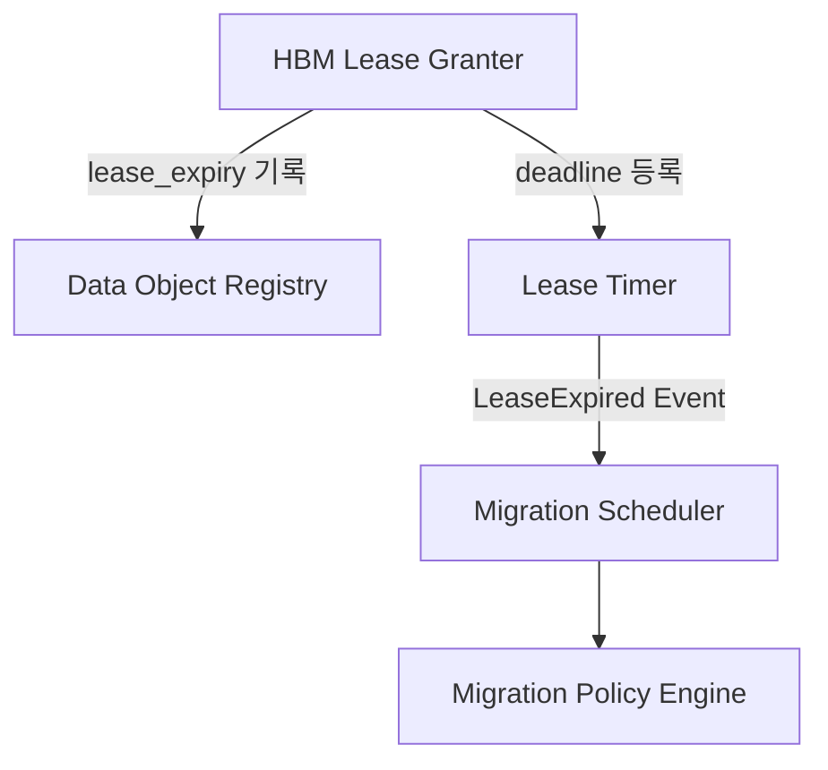
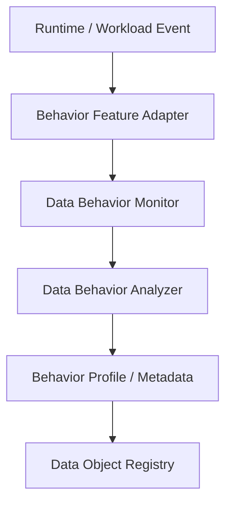
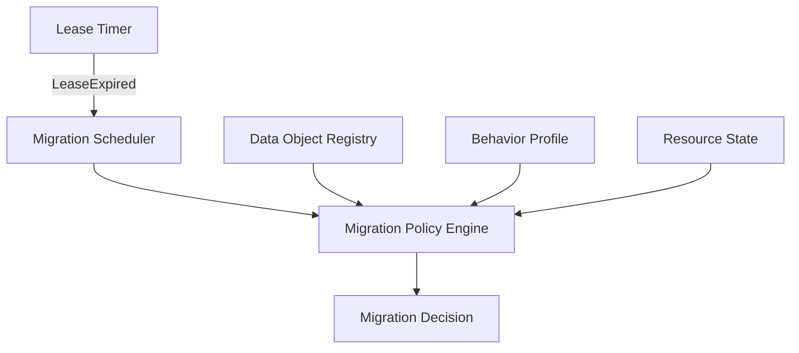
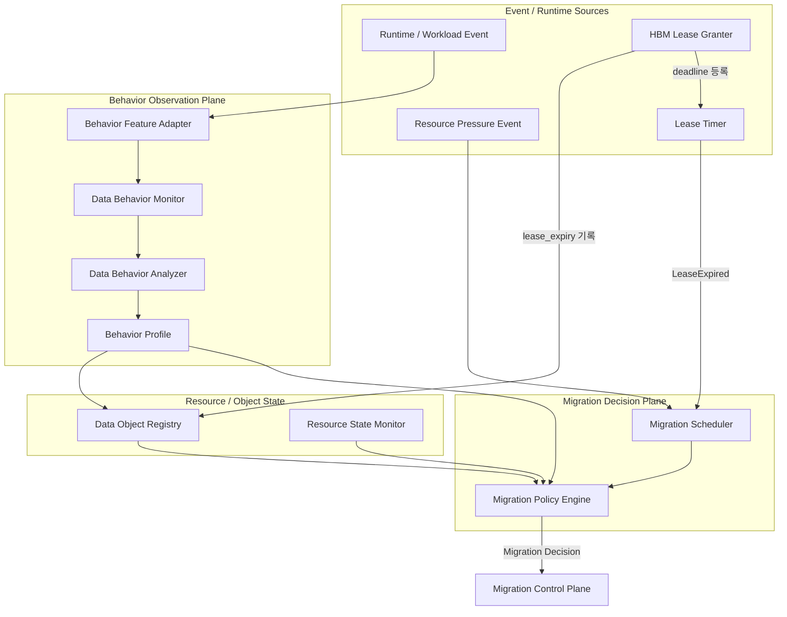

# DP1 C2 — Lease Timer / Behavior Monitoring Data Flow 정리

> 대상 브랜치: `claude/vllm-call-path-analysis-qxulkr`  
> 대상 설계: DP1 Candidate 2 — AI Data Behavior-driven Migration  
> 목적: HBM에 stage-in 된 data object의 lease 관리, Data Object Registry 갱신, behavior monitoring, migration trigger 간 책임과 data flow를 명확히 정의한다.

---

## 1. 결론 요약

C2의 lease / behavior / migration flow는 아래처럼 역할을 분리하는 것이 가장 명확하다.

1. **Data Object Registry**는 object의 현재 상태를 보관하는 source of truth다.
2. **HBM Lease Granter**는 HBM stage-in 시 lease duration / expiry를 결정한다.
3. **Lease Timer**는 expiry deadline을 등록하고 실제 시간 경과에 따라 만료 여부를 감시한다.
4. **Lease Timer는 Migration Scheduler 밖에 두는 것을 권장**한다.
5. **Lease 만료는 behavior 자체가 아니라 migration evaluation trigger**이므로, expiry event는 `Migration Scheduler → Migration Policy Engine`으로 전달한다.
6. **Behavior Feature Adapter → Data Behavior Monitor → Data Behavior Analyzer** 경로는 workload/runtime event를 관찰하여 behavior state를 지속적으로 갱신하는 별도 observation path다.
7. Lease expiry마다 behavior pipeline을 다시 통과할 필요는 없다. Policy Engine이 기존에 누적된 behavior state와 resource state를 참조해 `KEEP / EXTEND / DEMOTE / FREE` 등을 결정한다.

---

## 2. Component Responsibility

### 2.1 Data Object Registry

Data Object Registry는 runtime-managed AI data object의 현재 상태를 보관한다.

예시 metadata:

```text
Object A
 ├─ object_id
 ├─ data_type              # KV / LoRA / MoE / Agent Memory / ...
 ├─ size
 ├─ current_tier           # HBM / DRAM / CXL / HBF / SSD / ...
 ├─ lease_expiry
 ├─ last_access
 ├─ access_count
 ├─ behavior_profile_ref
 └─ migration_state
```

Registry는 timer처럼 시간을 직접 측정하지 않는다. 또한 lease expiry 여부를 스스로 polling하는 주체도 아니다.

핵심 책임은 다음과 같다.

- object 위치 / 크기 / 상태 저장
- lease metadata 저장
- behavior 관련 metadata 또는 Behavior Profile 참조 저장
- migration commit 결과 반영

즉 **상태 저장소**이지 **시간 감시자**나 **migration trigger 발생 주체**가 아니다.

---

### 2.2 HBM Lease Granter

HBM Lease Granter는 object가 HBM에 stage-in 되었을 때 해당 object의 HBM residency lease를 부여한다.

예:

```text
Object A stage-in to HBM
        ↓
Lease duration = 5 sec
        ↓
expiry_time = now + 5 sec
```

Lease Granter는 lease 부여 시 두 곳에 정보를 전달한다.

```text
HBM Lease Granter
   ├─→ Data Object Registry
   │      lease_expiry 기록
   │
   └─→ Lease Timer
          (object_id, expiry_time) 등록
```

Lease 연장 시에도 동일하게 Registry와 Lease Timer의 deadline을 갱신한다.

---

### 2.3 Lease Timer

Lease Timer는 **HBM-resident object의 lease expiration deadline을 관리하고 만료 시 event를 발생시키는 모듈**이다.

Lease Timer가 매 tick마다 다음처럼 Registry를 갱신하는 구조는 권장하지 않는다.

```text
remaining_lease = 5
remaining_lease = 4
remaining_lease = 3
...
```

대신 `expiry_time`을 등록한 뒤 system clock / OS timer를 이용해 deadline 도달 여부를 확인한다.

```text
Object A → expiry 10:30:15
Object B → expiry 10:30:21
Object C → expiry 10:31:02
```

그리고 만료 시:

```text
Lease Timer
    ↓
LeaseExpired(Object A)
```

이벤트를 발생시킨다.

구현은 polling도 가능하지만 object 수가 커지는 환경에서는 다음 형태가 더 적합하다.

- min-heap 기반 deadline queue
- timer wheel
- event/timer callback

따라서 Lease Timer가 자체적으로 시간을 "카운트"한다기보다 **system time을 기준으로 등록된 deadline을 관리**한다고 보는 것이 정확하다.

---

## 3. Lease Timer의 위치

Lease Timer는 Migration Scheduler 내부보다 **외부 독립 component로 두는 것을 권장**한다.

### 3.1 권장 구조



### 3.2 이유

Migration Scheduler의 책임은 여러 event를 받아 migration decision cycle을 시작하는 **orchestrator**다.

```text
ResourcePressure Event ─┐
LeaseExpired Event ─────┤
BehaviorChange Event ───┼→ Migration Scheduler
MemoryStateChange Event ┘
```

반면 Lease Timer는 특정 event source 중 하나다.

따라서 둘을 분리하면 다음 책임이 명확해진다.

- Lease Timer: 시간 / deadline 관리
- Migration Scheduler: event orchestration
- Migration Policy Engine: migration decision

---

## 4. Lease Expired Event는 어디로 가야 하는가

Lease expiry는 **behavior observation event가 아니라 migration decision을 시작시키는 trigger**다.

따라서 기본 경로는 다음과 같다.

```text
Lease Timer
    ↓ LeaseExpired(object_id)
Migration Scheduler
    ↓
Migration Policy Engine
```

Lease expiry마다 아래 경로를 다시 타는 것은 기본 구조로 권장하지 않는다.

```text
Migration Scheduler
    ↓
Behavior Feature Adapter
    ↓
Data Behavior Monitor
    ↓
Data Behavior Analyzer
    ↓
Migration Policy Engine
```

그 이유는 Behavior Monitor / Analyzer가 lease expiry 시점에 behavior를 새로 만들어 내는 주체가 아니기 때문이다.

Behavior state는 runtime 실행 중 이미 지속적으로 관찰 / 갱신되고, Policy Engine은 expiry 시점에 그 최신 state를 읽으면 된다.

---

## 5. Behavior Observation Path

Behavior path는 lease trigger path와 분리한다.



### 5.1 Behavior Feature Adapter

Workload / data type별 raw signal을 공통 behavior feature로 변환한다.

예:

```text
KV
 └─ token/session access, recency

LoRA
 └─ request frequency, model reuse

MoE
 └─ expert activation frequency

Agent Memory
 └─ session activity, tool-wait state

        ↓

Common Behavior Feature
 ├─ hotness
 ├─ reuse tendency / probability
 ├─ expected lifetime
 ├─ access trend
 ├─ latency sensitivity
 └─ bandwidth sensitivity
```

이 Adapter를 통해 신규 workload가 추가되더라도 Analyzer / Policy의 변경 범위를 줄일 수 있다.

### 5.2 Data Behavior Monitor

Adapter가 제공한 feature를 object 단위로 누적 / 추적한다.

예:

- last access
- access frequency
- reuse interval
- recency
- lifetime observation

### 5.3 Data Behavior Analyzer

Monitor가 누적한 behavior를 해석하여 migration policy가 사용할 behavior state를 생성한다.

Analyzer에는 기존 `Behavior-based Trend Analyzer`와 `Behavior Predictor`의 기능을 통합할 수 있다.

권장 abstraction:

```text
Data Behavior Analyzer
 ├─ Hotness Analysis
 ├─ Reuse Analysis
 ├─ Lifetime Analysis
 ├─ Trend Analysis
 └─ Behavior Prediction
```

상위 architecture에서는 별도 Predictor block을 노출하지 않고,

```text
Behavior Feature Adapter
        ↓
Data Behavior Monitor
        ↓
Data Behavior Analyzer
        ↓
Migration Policy Engine
```

으로 단순화하는 것을 권장한다.

---

## 6. Migration Decision Path

Migration Policy Engine은 lease expiry와 같은 trigger를 받으면 behavior / resource / object state를 조합해 migration 여부를 판단한다.



예를 들어 lease가 만료된 Object A가 다음 상태라면:

```text
Object A
- current_tier    = HBM
- lease_expired   = true
- hotness         = HIGH
- reuse tendency  = HIGH
- HBM pressure    = LOW
```

Policy Engine은 `KEEP / EXTEND LEASE`를 선택할 수 있다.

반대로:

```text
Object B
- current_tier    = HBM
- lease_expired   = true
- hotness         = LOW
- reuse tendency  = LOW
- HBM pressure    = HIGH
```

이면 `DEMOTE`가 더 적절하다.

즉:

> **Lease expiry는 곧바로 migration을 의미하지 않는다.**  
> **Lease expiry는 해당 object의 HBM residency를 다시 평가하는 trigger다.**

---

## 7. Behavior State가 Stale한 경우

기본 구조에서는 lease expiry마다 behavior pipeline을 다시 수행하지 않는다.

다만 Policy Engine이 참조하려는 behavior state가 일정 시간 이상 갱신되지 않았다면 선택적으로 refresh 경로를 둘 수 있다.

```text
LeaseExpired
     ↓
Migration Scheduler
     ↓
Behavior state stale?
     ├─ No  → Migration Policy Engine
     └─ Yes → Behavior refresh → Migration Policy Engine
```

이 refresh는 예외 경로이며, 기본 control flow는 아니다.

---

## 8. Registry Metadata는 누가 갱신하는가

Registry metadata 전체를 하나의 timer가 주기적으로 갱신하는 대신, **각 state를 관찰 / 변경한 주체가 자신의 책임 범위만 event-driven 방식으로 갱신**한다.

| Metadata | 주요 갱신 주체 | 갱신 시점 |
|---|---|---|
| `current_tier`, `location` | Migration Executor / Memory Manager | stage-in/out, migration commit |
| `lease_expiry` | HBM Lease Granter | lease 부여 / 연장 |
| `last_access`, `access_count` | Data Behavior Monitor / runtime access hook | 실제 access 발생 |
| `hotness`, `reuse tendency` | Data Behavior Analyzer | behavior 분석 / prediction |
| `type`, `size` | Object 생성 / 등록 주체 | object registration |
| `migration_state` | Migration subsystem | migration state transition |

권장 구조는 Registry에 공통 Metadata Update API를 두는 것이다.

```text
Migration Executor ─┐
HBM Lease Granter ──┤
Behavior Monitor ───┼→ Data Object Registry
Behavior Analyzer ──┤     (Metadata Update API)
Object Manager ─────┘
```

이렇게 하면 Registry는 single source of truth를 유지하면서, 개별 component의 책임도 명확해진다.

---

## 9. 전체 권장 Architecture



이 구조의 핵심은 세 plane의 책임 분리다.

### Observation Plane

> Data가 runtime에서 어떻게 사용되고 있는가?

- Behavior Feature Adapter
- Data Behavior Monitor
- Data Behavior Analyzer

### Resource / State Plane

> Data가 어디에 있고 resource 상태는 어떠한가?

- Data Object Registry
- Resource State Monitor

### Decision Plane

> 지금 migration을 수행해야 하는가? 한다면 어떤 action을 선택할 것인가?

- Migration Scheduler
- Migration Policy Engine

Lease Timer는 이 Decision Plane을 깨우는 **event source**로 본다.

---

## 10. Architecture Diagram 수정 시 권장 사항

기존 C2 구조도에서 다음을 반영하는 것을 권장한다.

### 변경 1. Lease Timer를 Migration Scheduler 밖으로 이동

기존:

```text
Migration Scheduler
 └─ Lease Timer
```

권장:

```text
Lease Timer
    ↓ LeaseExpired Event
Migration Scheduler
```

### 변경 2. `Lease Timer → Data Object Registry` expiry-event 화살표 제거

Lease Timer가 Registry에 `Lease Expired → Demote/Free Trigger`를 보내는 형태는 제거한다.

대신:

```text
HBM Lease Granter → Data Object Registry
                   lease_expiry 기록

Lease Timer → Migration Scheduler
              LeaseExpired Event
```

으로 분리한다.

### 변경 3. Behavior Analyzer와 Predictor 통합

기존:

```text
Data Behavior Monitor
    ↓
Behavior-based Trend Analyzer
    ↓
Behavior Predictor
    ↓
Migration Policy Engine
```

권장:

```text
Behavior Feature Adapter
    ↓
Data Behavior Monitor
    ↓
Data Behavior Analyzer
    ↓
Migration Policy Engine
```

`Data Behavior Analyzer` 내부 기능으로 trend analysis / prediction을 포함한다.

### 변경 4. Lease Expiry와 Behavior Observation 경로 분리

```text
[Behavior Observation]
Runtime Event
 → Adapter
 → Monitor
 → Analyzer
 → Behavior Profile

[Migration Trigger]
Lease Expired
 → Migration Scheduler
 → Migration Policy Engine
```

Policy Engine이 Behavior Profile / Data Object Registry / Resource State를 참조하도록 한다.

---

## 11. Design Rationale

이 구조를 선택하는 이유는 다음과 같다.

1. **책임 분리**  
   Timer, state storage, behavior observation, migration decision의 역할이 명확해진다.

2. **불필요한 polling 감소**  
   lease remaining time을 매 tick Registry에 기록하지 않고 deadline 기반으로 관리한다.

3. **Behavior pipeline 중복 수행 방지**  
   lease expiry마다 Monitor / Analyzer를 재수행하지 않고 이미 누적된 behavior state를 재사용한다.

4. **Modifiability 개선**  
   신규 workload는 Behavior Feature Adapter를 통해 공통 feature로 정규화하고, analyzer / policy 변경을 최소화한다.

5. **Scalability 개선 여지**  
   deadline queue와 event-driven flow를 사용하면 object 수가 증가해도 전체 Registry를 주기적으로 scan하는 구조보다 효율적으로 확장할 수 있다.

---

## 12. 한 문장 정의

> **Lease Timer는 HBM residency deadline을 관리하는 event source이고, Behavior Monitor/Analyzer는 runtime usage를 관찰하는 observation path이며, Migration Scheduler/Policy Engine은 lease expiry 시 기존 behavior·resource state를 참조해 migration 여부를 결정한다.**
